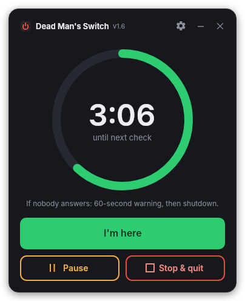
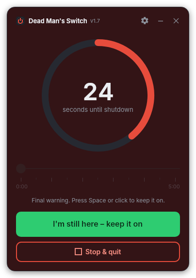
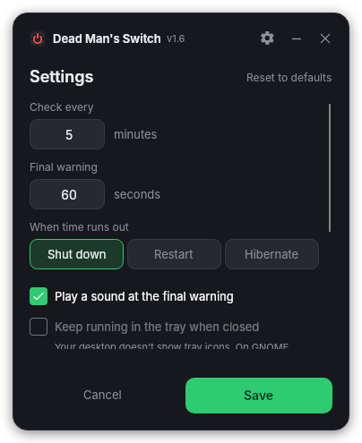
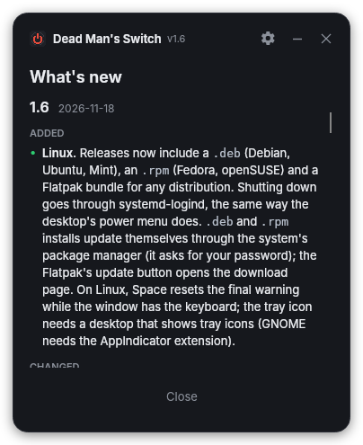
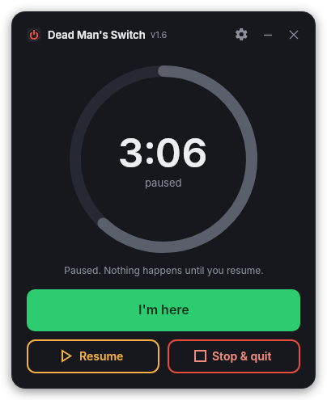
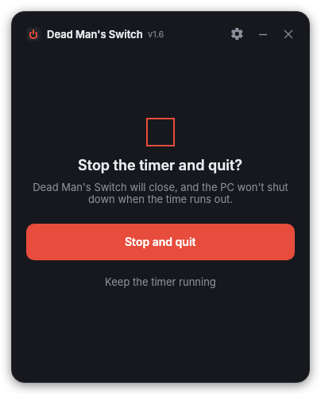

# Dead Man's Switch

A small app for **Windows and Linux** that shuts the PC down unless someone keeps
confirming they're still there. Useful for leaving a machine running (a
download, a render, a game server) without it staying on all night if you fall
asleep or walk away.

<p>
  
  
  
  
  
  
</p>

## How it works

1. A window stays on top with a green ring counting down to the next check
   (5 minutes unless you change it).
2. Clicking **I'm here** refills the ring and starts the countdown again.
   **Pause** freezes it until you click **Resume**. Pause and **Stop & quit**
   ask you to confirm first.
3. If the ring runs out, the window turns red and the **final warning** starts
   (60 seconds unless you change it). It plays a sound and pulls itself to the
   front every 2 seconds, even if minimized or in the tray. Press **Space** or
   **Enter**, or click the button, to reset the timer. On Windows, Space works
   from any app while the warning is up.
4. If nobody responds before the warning ends, the PC shuts down, restarts or
   hibernates, depending on the setting.

**Stop & quit** closes the app without doing anything. Only one copy runs at a
time; starting it again brings up the one already running.

## Install

Everything is on the [latest release](https://github.com/samschultzponsys/dead-mans-switch/releases/latest).
No .NET or other runtime needs installing; it's all included.

### Windows

Download `DeadMansSwitch-Setup-X.Y.exe` and run it. The first page asks how to
set it up:

- **Install (recommended):** installs for your Windows account only, so it
  needs no admin rights, into `%LOCALAPPDATA%\Programs\DeadMansSwitch`. It adds
  a Start menu entry (desktop shortcut optional) and lists the app in
  Settings > Apps, where you can uninstall it.
- **Portable:** copies the app into a folder you choose and adds nothing to
  Windows. Its settings are kept in that folder too, so you can move it or carry
  it on a USB stick. To remove it, delete the folder.

Windows 10 or 11, 64-bit. The installer isn't code-signed yet, so SmartScreen may
say it "protected your PC" the first time; choose **More info > Run anyway**.

### Linux

64-bit (x86_64). Pick the package for your system:

| System | Download | Install |
|---|---|---|
| Debian, Ubuntu, Mint, Pop!_OS | `dead-mans-switch_X.Y_amd64.deb` | `sudo apt install ./dead-mans-switch_X.Y_amd64.deb` |
| Fedora, RHEL, openSUSE | `dead-mans-switch-X.Y-1.x86_64.rpm` | `sudo dnf install ./dead-mans-switch-X.Y-1.x86_64.rpm` |
| Any distribution (Flatpak) | `DeadMansSwitch-X.Y.flatpak` | `flatpak install --user ./DeadMansSwitch-X.Y.flatpak` |

Double-clicking the downloaded file also opens it in most software centres. It
then appears in your app menu as **Dead Man's Switch**, or run
`dead-mans-switch` (Flatpak: `flatpak run io.github.samschultzponsys.DeadMansSwitch`).

On Linux:

- **Shutting down** goes through systemd-logind, the same way the desktop's own
  power menu does. If other people are signed in to the same PC, logind may
  refuse, and the app shows why instead of closing.
- **Bringing the window forward**: the desktop decides whether an app may take
  the focus. The window always stays above other windows, but on some desktops
  (GNOME on Wayland in particular) you may need to click it before Space works.
- **Tray icon**: KDE, Cinnamon, XFCE, Budgie and Ubuntu's desktop show it. Stock
  GNOME (e.g. Fedora Workstation) needs the
  [AppIndicator extension](https://extensions.gnome.org/extension/615/appindicator-support/);
  without one, the tray setting is unavailable and closing the window quits.

## Tray icon

The first time you close the window (×), the app asks whether to keep running
in the system tray or quit, and remembers the answer. You can change it later
in Settings. In the tray, the timer keeps counting:

- Click the icon to open the window.
- Right-click for **I'm here**, **Pause**/**Resume** and **Stop timer and quit**
  (Pause and quitting ask to confirm in the window).
- Hover over it to see the time left.

## Settings

Click the gear in the title bar:

| Setting | Default | Range |
|---|---|---|
| Check every | 5 minutes | 1-1440 minutes |
| Final warning | 60 seconds | 10-600 seconds |
| When time runs out | Shut down | Shut down, Restart, Hibernate |
| Play a sound at the final warning | On | |
| Keep running in the tray when closed | Asked the first time you close it | |
| Check for updates when the app opens | On | |
| Install them automatically | On | |
| GitHub token | None | Optional |

**Reset to defaults** fills in the default values (it leaves a saved token
alone); click **Save** to keep them. **Save** applies the settings right away:
a running check restarts with the new length, and a final warning already in
progress keeps its length. Delete the settings file to go back to the defaults:

| | Settings file |
|---|---|
| Windows | `%APPDATA%\DeadMansSwitch\settings.json` (portable: `settings.json` beside the exe) |
| Linux (.deb, .rpm) | `~/.config/DeadMansSwitch/settings.json` |
| Linux (Flatpak) | `~/.var/app/io.github.samschultzponsys.DeadMansSwitch/config/DeadMansSwitch/settings.json` |

### GitHub token

Update checks work without a token. Add one if the repository is made private,
or if GitHub starts limiting anonymous update checks (60 an hour per network).
A [fine-grained token](https://github.com/settings/personal-access-tokens/new)
with read-only access to this repository's **Contents** is enough. When you
save, the app checks the token with GitHub and only keeps it if it works. It's
never shown again; paste a new one to replace it, or use **Remove the saved
token**.

On Windows the token is stored encrypted for your Windows account (DPAPI); a
portable copy moved to another PC or account can't read it and carries on
without it. On Linux it's stored in the settings file, which only your user can
read.

## What's new and updates

Click the version next to the title (for example `v1.6`) to see the changelog.
It also opens by itself the first time a new version runs.

When the app opens it asks GitHub for this repo's releases. If there's a newer
version and **Install them automatically** is on, it updates straight away and
reopens on the new version, showing what changed:

- **Windows:** the new installer runs with just a progress window. An installed
  copy is updated in place (Settings > Apps shows the new version); a portable
  copy is updated in its own folder.
- **Linux .deb / .rpm:** the new package is downloaded and installed with your
  system's package manager, so the system asks for your password first.
- **Flatpak:** a sandboxed app can't update itself, so the update button opens
  the download page instead. Install the new `.flatpak` the same way as the
  first one.

While the app is running it checks again every 6 hours, but doesn't interrupt:
a banner offers the update, and its notes are shown once. With automatic
installs off, the same happens at launch. If GitHub can't be reached, nothing
is shown and the timer runs as normal.

## Versioning

Versions are `MAJOR.MINOR`, where the minor is a single digit that rolls over
after 9:

```
1.1 → 1.2 → … → 1.9 → 2.0 → 2.1 → … → 2.9 → 3.0
```

Each release moves up by exactly one step. The current version is in the
`VERSION` file, which the build stamps into the app. Releases are tagged
`vMAJOR.MINOR` (for example `v1.6`) by the build.

## Making a release

1. Note the changes under `## [Unreleased]` in `CHANGELOG.md`.
2. Move to the next version, which also dates that changelog section
   (PowerShell, on Windows or with `pwsh` on Linux):
   ```powershell
   ./tools/Bump-Version.ps1
   ```
3. Commit and push to `main`.

GitHub Actions builds every push and tests each download the way it's
installed: the Windows installer in both modes, the `.deb` on Debian, the
`.rpm` on Fedora and the Flatpak bundle, each running the app's self-test.
When `VERSION` holds a version that hasn't been released yet, a push to `main`
also tags it `vMAJOR.MINOR` and publishes a GitHub Release with all four
downloads and the changelog section as its notes. Installed copies pick it up
the next time they open.

## Building locally

With the [.NET 8 SDK](https://dotnet.microsoft.com/download), on Windows or
Linux:

```
dotnet publish src/DeadMansSwitch/DeadMansSwitch.csproj -c Release -r linux-x64 -o dist/linux-x64
```

Use `-r win-x64 -o dist/win-x64` for Windows. Then, to check it:

```
dist/linux-x64/DeadMansSwitch --selftest
dist/linux-x64/DeadMansSwitch --screenshot shots
```

The self-test runs without a display and exits with code 0 if it passes;
`--screenshot` saves a PNG of each screen. To build the Linux packages from a
`linux-x64` publish (needs `dpkg-deb` and `rpmbuild`):

```
packaging/linux/build-packages.sh "$(cat VERSION)" dist/linux-x64 dist
```

## Project layout

```
src/DeadMansSwitch/
  App.axaml                   colours, font, icons and control styles
  MainWindow.axaml            window layout
  MainWindow.axaml.cs         timer phases, ring, panels, tray and close handling
  Platform.cs                 what differs between Windows and Linux
  WindowsNative.cs            Win32 calls (focus, Space hotkey, sound)
  LinuxDesktop.cs             D-Bus calls (logind shutdown, tray check) and sound
  Settings.cs                 settings file
  Updater.cs                  release check and install, per kind of install
  Changelog.cs                built-in changelog and its renderer
  SingleInstance.cs           one copy per user
  Program.cs                  entry point, --selftest, --screenshot
assets/                       icon (tools/make_icon.py), Inter font, warning sound
installer/DeadMansSwitch.iss  Windows installer (Inno Setup)
packaging/linux/              .deb/.rpm build, desktop entry, AppStream metadata
packaging/flatpak/            Flatpak manifest
tools/Bump-Version.ps1        version bump + changelog
.github/workflows/build.yml   builds, package tests and releases
```

The app is C# on .NET 8 with [Avalonia](https://avaloniaui.net/) for the
interface. Versions 1.1-1.5 were Windows-only (WPF); before that it was a
PowerShell script packaged with ps2exe. Both are in the git history.
